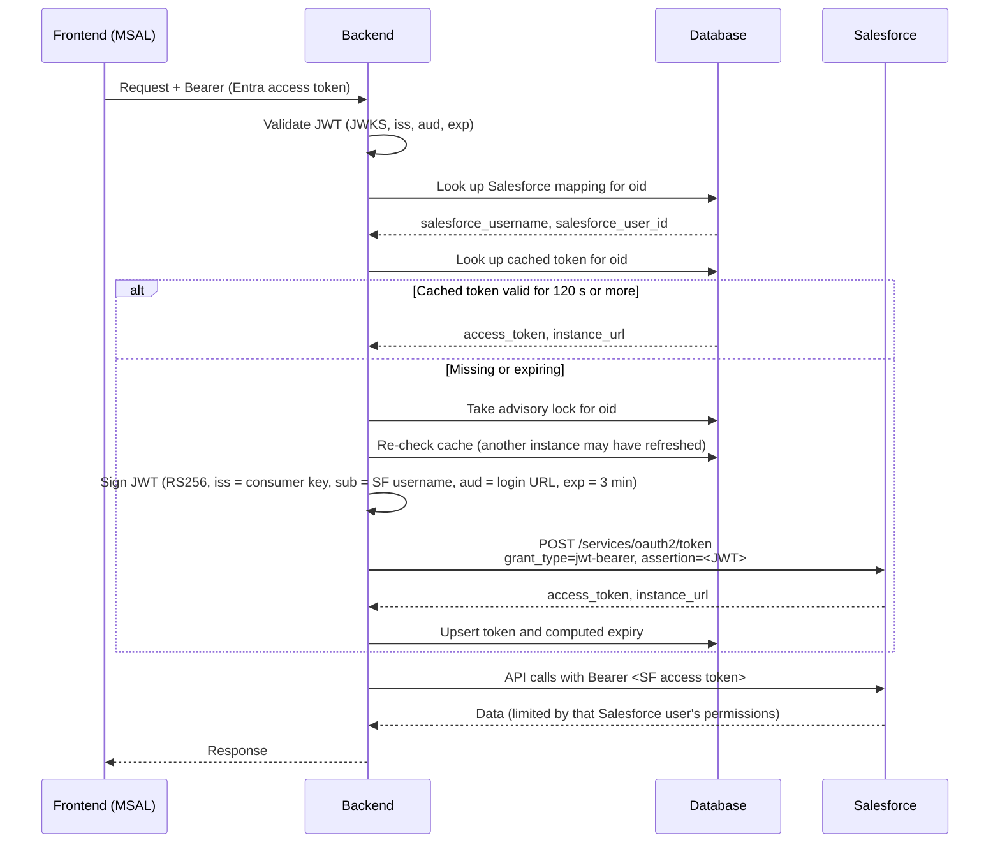

# Salesforce delegated authentication

How a backend can call Salesforce on behalf of a user who has signed in with another identity provider, here Microsoft Entra ID (MSAL). The backend never forwards the user's Microsoft token to Salesforce. Instead it obtains a separate Salesforce access token for the matching Salesforce user through the **OAuth 2.0 JWT Bearer flow**.

## Summary

- Users sign in to the frontend with **Microsoft Entra ID** (MSAL). The backend validates the resulting access token (see [[Identity token vs Access Token]]).
- The backend reaches Salesforce with an access token it obtains itself, by signing a short-lived JWT assertion with a private key. The assertion names the Salesforce user to impersonate.
- The link between the two identities is a mapping from the Entra object ID (`oid`) to a Salesforce username and user ID. It is created on first login by matching the user's email against the Salesforce `User.FederationIdentifier` field.
- Salesforce access tokens are cached per user and refreshed shortly before they expire.

## Building blocks

| Component | Role |
| --- | --- |
| MSAL browser client | Signs the user in and acquires an access token for the backend API (`api://<client-id>/access_as_user`) |
| Entra JWT validation | Verifies signature, issuer, audience and expiry against the tenant's JWKS |
| Optional group gate | Restricts access to members of given Entra groups |
| Identity mapping | Stores the Entra-to-Salesforce user link, created on first login |
| Token manager | Cache lookup, locking and refresh of Salesforce tokens |
| JWT Bearer minting | Builds the signed assertion and calls the Salesforce token endpoint |
| Private key store | A secrets manager in deployed environments, an env file locally |
| Integration user | A privileged Salesforce user for lookups no regular user can perform |
| Salesforce connected app | Registers the backend as a trusted OAuth client in the Salesforce org |

## The Salesforce connected app

A **connected app** is the Salesforce-side registration of an external application. Salesforce does not accept OAuth requests from unknown clients. Every client must first be registered as a connected app, which gives Salesforce a record of who the client is, how it proves it, and what it may do. Here, the connected app is the registration of the backend itself as a trusted API client.

### What it defines

| Setting | Role |
| --- | --- |
| **Consumer key** | Public identifier of the app. The backend sends it as `iss` in the JWT assertion. |
| **Digital certificate** | The public half of the key pair. Salesforce uses it to verify the assertion's signature. The private key stays with the backend. |
| **OAuth scopes** | The upper limit of what any token issued to this app can do, for example `api`. |
| **Permitted Users policy** | Set to "Admin approved users are pre-authorized". Users cannot approve the app themselves, which suits a flow with no browser. An admin grants access through profiles or permission sets. |
| **Session policies** | Control token lifetime. The backend's assumed token lifetime should match them. |

The connected app has a consumer secret as well, but the JWT Bearer flow does not use it. The signature takes its place.

### How Salesforce checks an assertion

1. **App.** The `iss` value must match a known connected app.
2. **Signature.** The signature must verify against that app's certificate. This shows the request comes from the backend and not from someone who only knows the consumer key.
3. **User.** The user in `sub` must be pre-authorized for that app. This lets Salesforce control which people can be impersonated, independently of the backend.

Only after all three pass does Salesforce issue an access token for that user. That token carries the user's own permissions, limited further by the app's scopes. The connected app does not grant extra access. It only allows the backend to act as users who already have access.

### One app, many users

A single connected app serves the backend. It is shared by all application users and by the integration user. What identifies the person is `sub` in the assertion, not the app. Each user's Salesforce data access therefore stays governed by their own profile, permission sets and sharing rules.

### Operational consequences

- **Key rotation.** Replacing the private key means uploading the new certificate to the connected app. The old and new key must overlap during the change, or the backend will get `invalid_grant` errors.
- **Onboarding.** A new user needs a pre-authorizing profile or permission set before the backend can mint tokens for them, in addition to the `FederationIdentifier` described below.
- **Environments.** Sandboxes and production each have their own connected app, with their own consumer key and certificate. The consumer key, login URL and private key must all come from the same environment.
- **Connected apps and external client apps.** Salesforce is moving new integrations towards *external client apps*, a newer packaging model for the same OAuth settings. The JWT Bearer flow works the same way in both.

## Two identities, one mapping

A signed-in user has two identities:

| | Microsoft | Salesforce |
| --- | --- | --- |
| Identifier | `oid` claim (Entra object ID) | `User.Id` and `User.Username` |
| Used as | Key of the mapping and of the token cache | `sub` of the JWT assertion; owner ID in queries |
| Email | `upn`, `email`, `preferred_username` or `unique_name` claim | `User.FederationIdentifier` |

The mapping can be a simple table:

```sql
CREATE TABLE user_salesforce_accounts (
  user_id             text PRIMARY KEY REFERENCES users(id) ON DELETE CASCADE,
  salesforce_username text NOT NULL,
  salesforce_user_id  text NOT NULL,
  created_at          timestamptz NOT NULL DEFAULT now()
);
```

`user_id` holds the Entra `oid`. A token cache table can reference it so that cached tokens are deleted along with the mapping.

### Creating the mapping

After login, the frontend calls a validation endpoint. The backend then:

1. Validates the Microsoft token and the optional group gate.
2. Upserts the application user.
3. Looks for an existing mapping.
4. If none exists, queries Salesforce **as the integration user** for an active, standard user whose `FederationIdentifier` equals the Microsoft email:

   ```sql
   SELECT Id, Username FROM User
   WHERE IsActive = true AND UserType = 'Standard'
     AND FederationIdentifier = '<email>'
   ```

5. If a match is found, stores `(oid, Username, Id)`. If not, it reports that the user has no Salesforce account, so the frontend can show that the user has no Salesforce access.

The mapping depends on one convention: **the user's Salesforce `FederationIdentifier` must equal their corporate email as it appears in the Entra token.** This is the same field Salesforce uses to match users in SAML SSO, so it is normally already populated.

If the mapping is written only when no row exists, a later change of Salesforce username leaves the stored row stale until it is deleted or upserted again.

## Authentication flow

### 1. Microsoft sign-in (MSAL)

The frontend signs the user in with `loginRedirect` (scopes `openid profile email`). For API calls it uses `acquireTokenSilent` with the scope `api://<client-id>/access_as_user`, then sends the token as `Authorization: Bearer <token>`.

### 2. Backend token validation

The backend:

- decodes the header and fetches the matching signing key from the tenant's JWKS endpoint;
- verifies the RS256 signature, expiry (with a small clock tolerance, e.g. 5 minutes), issuer (v1 or v2 for the configured tenant) and audience (`<client-id>` or `api://<client-id>`);
- builds a user from the claims (`oid`, `sub`, email, name, `groups`, `roles`).

A token without an `oid` is rejected, since `oid` is the key of the mapping.

### 3. Salesforce token acquisition

Requests that need Salesforce pass through three steps in order: token validation, group authorization, and attaching a Salesforce context (access token, instance URL, Salesforce user ID).



### The JWT Bearer assertion

| Claim | Value | Meaning |
| --- | --- | --- |
| `iss` | Consumer key | Identifies the connected app |
| `sub` | Salesforce username from the mapping | The user the token is issued for |
| `aud` | Login URL | `https://login.salesforce.com`, `https://test.salesforce.com`, or a My Domain URL |
| `exp` | now + 180 s | Short lifetime of the assertion only |

The assertion is signed with RS256 using the private key and posted to `<login URL>/services/oauth2/token` with `grant_type=urn:ietf:params:oauth:grant-type:jwt-bearer`. Salesforce returns an access token and the `instance_url`. The flow issues no refresh token and involves no user interaction. A new assertion is minted whenever a new access token is needed.

Salesforce does not return an expiry in this response. The backend has to compute it from a configured lifetime, and that lifetime must not exceed the session timeout configured in Salesforce for the connected app or org.

## Why it is safe

Salesforce never sees the Microsoft token. Trust is split into two links:

1. **User to backend.** The Entra token proves who the user is. The backend validates it fully on every request.
2. **Backend to Salesforce.** The private key proves the request comes from the backend. The connected app only accepts assertions signed by that key and only for users it has pre-authorized.

Which Salesforce user the backend impersonates is decided by the mapping for the validated `oid`. The client cannot supply a Salesforce username. Data access in Salesforce is still limited by that user's own profile, permission sets and sharing rules. Even if the API lets a user view another user's records (e.g. a "run as" parameter), the token is always the caller's, so Salesforce still enforces what the caller may read.

## Token storage and concurrency

- **Storage:** cache `user_id`, `access_token`, `instance_url` and `expires_at`. If the access token is stored as plain text, restrict access to the table like any other credential store.
- **Refresh threshold:** refresh a token with less than about 120 seconds left.
- **Locking:** run the refresh under a per-user [[Postgres advisory locks|advisory lock]] with a few retries and backoff, and check the cache again after taking the lock. This stops concurrent requests or backend instances from minting tokens for the same user at the same time.
- **Cleanup:** a periodic job deletes tokens that expired a while ago.

## The integration user

Some operations cannot be done with a normal user's token. The main one is looking up a Salesforce user by email before a mapping exists. For these, the backend uses a dedicated Salesforce **integration user**:

- It authenticates through the same JWT Bearer flow, so it needs a mapping entry like any other user.
- It is not tied to an application user's session and should only be used for the specific lookups that need it.
- It needs enough access to read `User` records.

## Configuration

| Setting | Purpose |
| --- | --- |
| Entra tenant ID and client ID | Validate Microsoft tokens |
| Allowed Entra group IDs | Optional access gate |
| Salesforce consumer key | `iss` of the assertion |
| Salesforce login URL | `aud` of the assertion, base of the token endpoint |
| Private key | Signs the assertion. Kept in a secrets manager; locally as an inline value with `\n` escapes |
| Access token lifetime | Assumed lifetime of an issued access token |
| Integration user ID | Identifies the integration user |

Load the key once at startup and keep it in memory. Fail Salesforce requests clearly if it is missing.

## Salesforce setup checklist

1. A **connected app** (or external client app) with OAuth enabled, a digital certificate matching the backend's private key, and the OAuth scopes the backend needs (typically `api`).
2. The app set to **"Admin approved users are pre-authorized"**, with each user pre-authorized (usually via profile or permission set). Otherwise Salesforce rejects the assertion with `invalid_grant`.
3. Each user's **`FederationIdentifier`** set to their corporate email.
4. An integration user with enough access to read `User` records.

## Failure modes

| Situation | Result |
| --- | --- |
| Missing, malformed or invalid Microsoft token | `401` |
| User not in an allowed group (when the gate is enabled) | `403` |
| No Salesforce user with a matching `FederationIdentifier` | Validation endpoint reports no Salesforce account |
| No mapping when calling a Salesforce route | Should be a `403`; easy to end up returning `500` instead |
| Salesforce rejects the assertion (user not pre-authorized, wrong certificate, deactivated user) | Salesforce returns `invalid_grant` with an `error_description` |
| Private key not loaded | Configuration error |

## Pitfalls

- Do not put the email straight into the SOQL string. Even though it comes from a validated token, escape it or use a parameterized helper (see [[sql-injection]]).
- Distinguish "user has no Salesforce account" (`403`) from real token failures (`500`).
- Decide how the mapping is refreshed if Salesforce usernames can change.

## Salesforce references

Salesforce reorganizes its help site often, so a link may move. Searching the article title usually finds it again.

- OAuth 2.0 JWT Bearer Flow for Server-to-Server Integration: https://help.salesforce.com/s/articleView?id=sf.remoteaccess_oauth_jwt_flow.htm
- Salesforce DX Developer Guide, "Authorize an Org Using the JWT Bearer Flow" (step-by-step certificate and connected app setup): https://developer.salesforce.com/docs/atlas.en-us.sfdx_dev.meta/sfdx_dev/sfdx_dev_auth_jwt_flow.htm
- OAuth Authorization Flows overview: https://help.salesforce.com/s/articleView?id=sf.remoteaccess_oauth_flows.htm
- Connected Apps overview: https://help.salesforce.com/s/articleView?id=sf.connected_app_overview.htm
- OAuth Tokens and Scopes: https://help.salesforce.com/s/articleView?id=sf.remoteaccess_oauth_tokens_scopes.htm
- `User` object reference (`FederationIdentifier`, `IsActive`, `UserType`): https://developer.salesforce.com/docs/atlas.en-us.object_reference.meta/object_reference/sforce_api_objects_user.htm
- Single Sign-On and federation IDs: https://help.salesforce.com/s/articleView?id=sf.sso_about.htm

## Microsoft references

- Microsoft Authentication Library (MSAL) overview: https://learn.microsoft.com/en-us/entra/identity-platform/msal-overview
- Access tokens in the Microsoft identity platform: https://learn.microsoft.com/en-us/entra/identity-platform/access-tokens
- Access token claims reference (`oid`, `upn`, `groups`): https://learn.microsoft.com/en-us/entra/identity-platform/access-token-claims-reference

## Related

- [[Identity token vs Access Token]]
- [[Cloud accounts and subscriptions]] (Entra ID tenants)
- [[Postgres advisory locks]]
